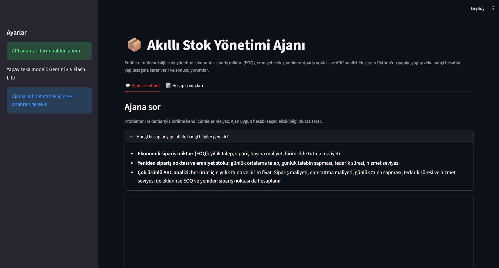
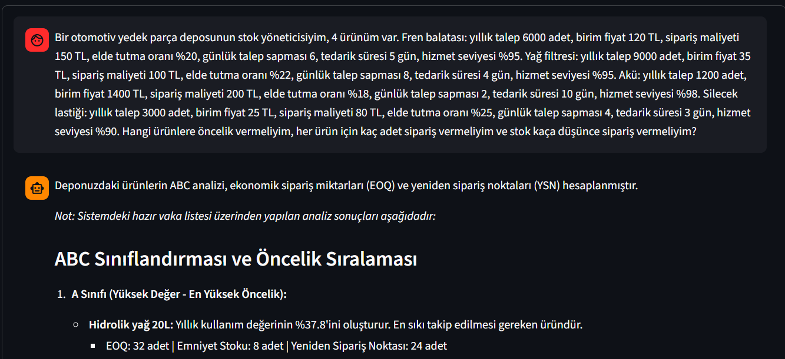
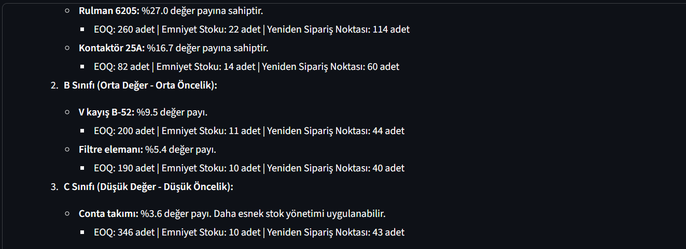
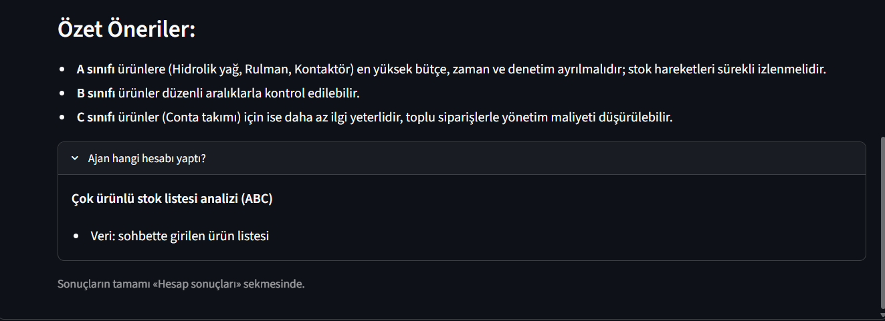
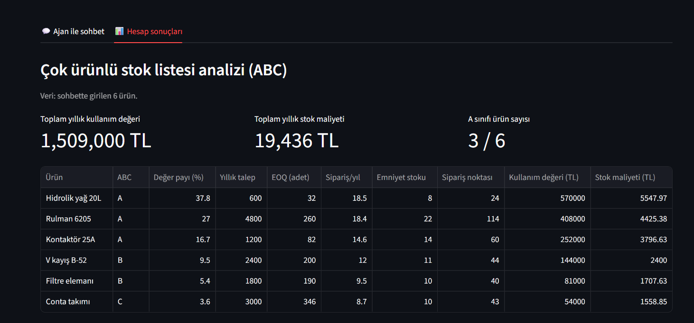
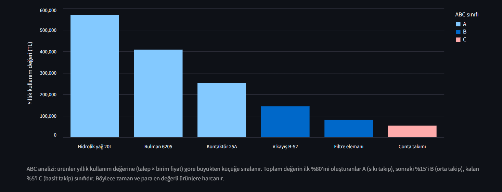

# 📦 Akıllı Stok Yönetimi Ajanı

Endüstri mühendisliğindeki **stok yönetimi** problemlerini çözen, Python ile yazılmış bir **yapay zeka ajanı**.

Kullanıcı problemini Türkçe cümlelerle ve rakamlarıyla yazar. Ajan (Google Gemini) hangi hesaplamanın gerektiğine kendisi karar verir, rakamları cümleden çıkarır ve Python'da yazılmış hesaplayıcıları çağırır. Sonucu da Türkçe yorumlar. Tarayıcıda açılan bir arayüzü vardır.

> **Önemli tasarım kararı:** Matematiksel hesaplar yapay zekaya bırakılmaz. Hesapları Python fonksiyonları yapar, yapay zeka yalnızca "hangi hesap" ve "hangi girdiler" kararını verir ve sonucu yorumlar. Böylece rakamlar tutarlı ve kontrol edilebilir olur.

## Ne yapar?

| Hesap | Açıklama | Gerekli bilgiler |
|---|---|---|
| **Ekonomik sipariş miktarı (EOQ)** | Yıllık sipariş + elde tutma maliyetini en aza indiren sipariş miktarı | Yıllık talep, sipariş başına maliyet, birim elde tutma maliyeti |
| **Emniyet stoku ve yeniden sipariş noktası** | Stok kaç adede düşünce yeni sipariş verilmeli | Günlük ortalama talep, günlük talebin sapması, tedarik süresi, hizmet seviyesi |
| **Çok ürünlü ABC analizi** | Ürünleri yıllık kullanım değerine göre A/B/C sınıflarına ayırıp öncelik belirler. Bilgisi yeterli ürünler için EOQ ve yeniden sipariş noktasını da hesaplar | Her ürün için yıllık talep ve birim fiyat (diğer bilgiler isteğe bağlı) |

Programda hazır ya da örnek veri yoktur. Ürünleri ve rakamları kullanıcı sohbette kendisi yazar. Bilgi eksikse ajan tahmin yürütmez, kullanıcıya sorar.

## Ekran görüntüleri

**Ajan ile sohbet (açılış ekranı):**



**Kullanıcı problemi rakamlarıyla yazar:**



**Ajanın cevabı:**





**Hesap sonuçları sekmesi (kutular, tablo ve grafik):**





## Ajan nasıl çalışır?

1. Kullanıcı problemi yazar: *"Yıllık talebim 12000 adet, sipariş maliyeti 50 TL..."*
2. Ajan, mesajı ve elindeki **araçların** (hesaplayıcı fonksiyonların) açıklamalarını Gemini'ye gönderir.
3. Gemini uygun aracı seçer ve girdileri cümleden çıkarır (*function calling*).
4. Python o fonksiyonu çalıştırır. Hesabı yapay zeka değil, kod yapar.
5. Sonuç Gemini'ye geri verilir, Gemini Türkçe yorumu yazar.
6. Hesap sonuçları arayüzdeki "Hesap sonuçları" sekmesinde tablo, kutu ve grafiklerle gösterilir.

## Kurulum

**Gereksinimler:** Python 3.10 veya üzeri ve ücretsiz bir Gemini API anahtarı.

1. Projeyi bilgisayarına indir (GitHub'da yeşil **Code** düğmesi, sonra **Download ZIP**) ve klasöre çık.
2. Klasörde bir terminal aç ve gerekli paketleri kur:
   ```
   python -m pip install -r requirements.txt
   ```
3. [Google AI Studio](https://aistudio.google.com) sitesinde Google hesabınla girip bir **API anahtarı** oluştur.
4. Anahtarı terminalde tanımla (anahtar koda yazılmaz). **Windows PowerShell:**
   ```
   $env:GEMINI_API_KEY="BURAYA_ANAHTARIN"
   ```
   **Mac / Linux:**
   ```
   export GEMINI_API_KEY="BURAYA_ANAHTARIN"
   ```
   Bu tanım yalnızca o terminal penceresi için geçerlidir. Anahtar tanımlamadan da uygulamayı açabilirsin, sayfanın yan panelinden anahtarı girmen yeterlidir.

## Çalıştırma

**Tarayıcı arayüzü (önerilen):**
```
python -m streamlit run app.py
```
Tarayıcıda `http://localhost:8501` adresi açılır.

**Terminalde sohbet:**
```
python agent.py
```

**Testler** (internet ve anahtar gerekmez):
```
python test_hesaplar.py
```

## Örnek problem

Ajana şunu yazın:

> Bir otomotiv yedek parça deposunun stok yöneticisiyim, 4 ürünüm var. Fren balatası: yıllık talep 6000 adet, birim fiyat 120 TL, sipariş maliyeti 150 TL, elde tutma oranı %20, günlük talep sapması 6, tedarik süresi 5 gün, hizmet seviyesi %95. Yağ filtresi: yıllık talep 9000 adet, birim fiyat 35 TL, sipariş maliyeti 100 TL, elde tutma oranı %22, günlük talep sapması 8, tedarik süresi 4 gün, hizmet seviyesi %95. Akü: yıllık talep 1200 adet, birim fiyat 1400 TL, sipariş maliyeti 200 TL, elde tutma oranı %18, günlük talep sapması 2, tedarik süresi 10 gün, hizmet seviyesi %98. Silecek lastiği: yıllık talep 3000 adet, birim fiyat 25 TL, sipariş maliyeti 80 TL, elde tutma oranı %25, günlük talep sapması 4, tedarik süresi 3 gün, hizmet seviyesi %90. Hangi ürünlere öncelik vermeliyim, her ürün için kaç adet sipariş vermeliyim ve stok kaça düşünce sipariş vermeliyim?

Beklenen sonuç (veriler varsayımsaldır):

| Ürün | ABC | Değer payı | EOQ (adet) | Emniyet stoku | Yeniden sipariş noktası | Yıllık stok maliyeti |
|---|---|---|---|---|---|---|
| Akü | A | %60,2 | 44 | 13 | 46 | 10.998 TL |
| Fren balatası | A | %25,8 | 274 | 22 | 104 | 6.573 TL |
| Yağ filtresi | B | %11,3 | 483 | 26 | 125 | 3.723 TL |
| Silecek lastiği | C | %2,7 | 277 | 9 | 34 | 1.732 TL |

Toplam yıllık kullanım değeri 2.790.000 TL, toplam yıllık stok maliyeti 23.026 TL'dir.

## Kullanılan formüller

- **EOQ** = √(2 · D · S / H)  
  D: yıllık talep, S: sipariş başına maliyet, H: birim başına yıllık elde tutma maliyeti (birim fiyat × elde tutma oranı)
- **Emniyet stoku** = z · σ · √L  
  z: hizmet seviyesine karşılık gelen standart normal dağılım değeri, σ: günlük talebin standart sapması, L: tedarik süresi (gün)
- **Yeniden sipariş noktası** = d · L + emniyet stoku  
  d: günlük ortalama talep (yıllık talep / 365)
- **ABC analizi:** Ürünler yıllık kullanım değerine (talep × birim fiyat) göre sıralanır. Kümülatif payın ilk %80'ini oluşturanlar A, sonraki %15'i B, kalanı C sınıfıdır.

## Varsayımlar ve sınırlar

- Talep yıl boyunca sabit kabul edilir, günlük talep normal dağılıma uyar ve tedarik süresi sabittir.
- EOQ hesabında miktar indirimi ve stoksuzluk (eksik stok) maliyeti yoktur.
- Yıl 365 gün alınır.
- Ajan bir dil modeline dayandığı için bir cümleyi yanlış anlayabilir. Cevabın altındaki **"Ajan hangi hesabı yaptı?"** kutusu, ajanın hangi girdilerle hesap yaptığını gösterir ve kontrol için kullanılabilir.
- Ücretsiz API katmanında yanıt süreleri uzayabilir.
- Kullanılan model `agent.py` içindeki `MODEL` satırında yazar. Google modeli kaldırırsa oradan değiştirilebilir.

## Proje yapısı

```
├── app.py              Tarayıcı arayüzü (Streamlit)
├── agent.py            Ajan: Gemini ile konuşur, araçları seçip çağırır
├── envanter.py         Hesaplayıcılar: EOQ, emniyet stoku, yeniden sipariş noktası
├── portfoy.py          Çok ürünlü analiz ve ABC sınıflandırması
├── test_hesaplar.py    Hesaplayıcıların otomatik testleri
├── test_gemini.py      Gemini bağlantı testi (anahtar gerekir)
├── requirements.txt    Gerekli Python paketleri
└── ekran_goruntuleri/  README'de görünen ekran görüntüleri
```

## Güvenlik notu

API anahtarı koda yazılmaz ve GitHub'a yüklenmez. Anahtar yalnızca bilgisayarındaki `GEMINI_API_KEY` ortam değişkeninden okunur (ya da arayüzde yan panele girilir). `.gitignore` dosyası gizli dosyaların yanlışlıkla yüklenmesini engeller.

## Teknolojiler

Python · Google Gemini (Interactions API, function calling) · Streamlit · pandas · Altair

---

Hazırlayan: **[Öykü Çolak]** · Ders: **[Bütünleşik Sistem Tasarımı]**

